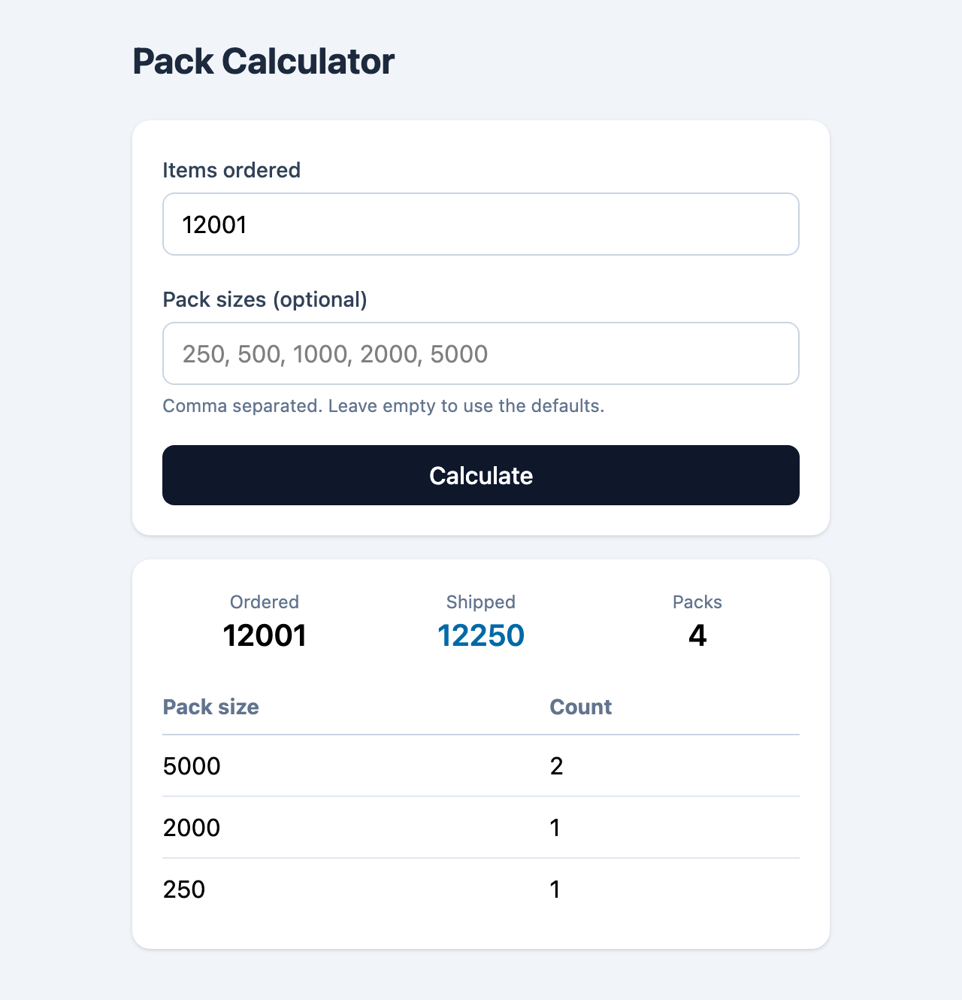

# Pack Calculator

A Go service that works out which packs to ship for an order, using only whole packs, sending as few items as possible and then as few packs as possible. It exposes an HTTP API and a small web UI.

**Live demo:** https://pack-calculator-vuy8.onrender.com

> **Note:** the app runs on Render's free tier, which spins the service down after about 15 minutes without traffic. The first request after that is a **cold start** and can take 30 to 60 seconds while the service starts up again. Requests after that respond immediately.



## Contents

- [The problem](#the-problem)
- [Project structure](#project-structure)
- [Running locally](#running-locally)
- [Testing](#testing)
- [API reference](#api-reference)
- [Deployment](#deployment)
- [Design decisions](#design-decisions)
- [Possible improvements](#possible-improvements)

## The problem

Products ship in fixed pack sizes (by default 250, 500, 1000, 2000 and 5000). For any number of items ordered, the calculator must follow these rules, in priority order:

1. Only whole packs can be sent. Packs cannot be broken open.
2. Send no more items than necessary to fulfil the order.
3. Within rules 1 and 2, send as few packs as possible.

| Items ordered | Correct packs | Items shipped |
|---|---|---|
| 1 | 1 × 250 | 250 |
| 250 | 1 × 250 | 250 |
| 251 | 1 × 500 | 500 |
| 501 | 1 × 500, 1 × 250 | 750 |
| 12001 | 2 × 5000, 1 × 2000, 1 × 250 | 12250 |

## Project structure

```
pack-calculator/
├── server/
│   ├── cmd/server/
│   │   └── main.go
│   └── internal/
│       ├── api/
│       │   ├── handlers.go
│       │   └── handlers_test.go
│       └── packing/
│           ├── calculator.go
│           └── calculator_test.go
├── web/
│   ├── index.html
│   └── web.go
├── docs/
│   └── screenshot.png
├── Dockerfile
├── .dockerignore
├── .gitignore
└── go.mod
```

- **`internal/`** packages can't be imported from outside the `server/` folder, which Go enforces. This keeps the domain logic (`packing`) and the transport layer (`api`) private.
- **`packing`** has no HTTP code in it, so the algorithm can be tested and reused on its own.
- **The UI is embedded** into the binary with `//go:embed`, so deploying it is one file with no separate frontend hosting.

## Running locally

### Prerequisites

- [Go 1.22+](https://go.dev/dl/), or
- [Docker](https://www.docker.com/) (no Go install needed)

### With Go

```bash
git clone https://github.com/mickyaujla/pack-calculator.git
cd pack-calculator
go run ./server/cmd/server
```

The server starts on **http://localhost:8000**. To use a different port, set `PORT`:

```bash
PORT=3000 go run ./server/cmd/server
```

### With Docker

```bash
docker build -t pack-calculator .
docker run --rm -p 8000:8000 pack-calculator
```

Then open **http://localhost:8000**.

## Testing

### Automated tests

```bash
go test ./...
```

With coverage:

```bash
go test -cover ./server/internal/...
```

Both `packing` and `api` have 100% statement coverage. The tests cover:

- Every example from the brief
- Cases where a greedy approach fails (6, 9, 20 with an order of 43)
- Large orders with unusual sizes (23, 31, 53 with an order of 500,000)
- A single pack size, unsorted sizes and duplicate sizes
- Invalid input: zero, negative or too many items, and empty, zero, negative or oversized pack sizes
- HTTP behaviour: status codes, malformed JSON, the wrong HTTP method, custom pack sizes, the health check and the UI route

### Manually: the UI

1. Start the server (see [Running locally](#running-locally)).
2. Open http://localhost:8000.
3. Enter the number of items. Optionally, enter pack sizes as a comma-separated list, e.g. `6, 9, 20`.
4. Click **Calculate**.

### Manually: Postman

1. Create a new request and set the method to **POST**.
2. Set the URL to `http://localhost:8000/api/calculate`.
3. Under **Body**, select **raw** and then **JSON**.
4. Enter the body:
   ```json
   {
     "items": 500000,
     "packSizes": [23, 31, 53]
   }
   ```
5. Click **Send**. Expected response: 9429 × 53, 7 × 31, 2 × 23 (500,000 items in 9,438 packs).

### Suggested test cases

These cases were used to test the app manually through the UI, and most are also covered by the automated tests.

| Items | Pack sizes | Expected packs | Shipped |
|---|---|---|---|
| 1 | default | 1 × 250 | 250 |
| 251 | default | 1 × 500 | 500 |
| 501 | default | 1 × 500, 1 × 250 | 750 |
| 751 | default | 1 × 1000 | 1000 |
| 12001 | default | 2 × 5000, 1 × 2000, 1 × 250 | 12250 |
| 43 | 6, 9, 20 | 1 × 20, 2 × 9, 1 × 6 | 44 |
| 100 | 30, 40, 60 | 1 × 60, 1 × 40 | 100 |
| 500000 | 23, 31, 53 | 9429 × 53, 7 × 31, 2 × 23 | 500000 |
| 0 | default | `400`: items must be greater than 0 | |
| 10 | 0, 250 | `400`: pack sizes must be greater than 0 | |

## API reference

### `POST /api/calculate`

Calculates the packs for an order.

**Request body**

| Field | Type | Required | Description |
|---|---|---|---|
| `items` | integer | Yes | Number of items ordered. Must be between 1 and 10,000,000. |
| `packSizes` | integer array | No | Pack sizes to use for this request. If omitted or empty, the server's default sizes are used. |

```json
{ "items": 501 }
```

**Response: `200 OK`**

```json
{
  "items": 501,
  "totalItems": 750,
  "totalPacks": 2,
  "packs": [
    { "size": 500, "count": 1 },
    { "size": 250, "count": 1 }
  ]
}
```

| Field | Description |
|---|---|
| `items` | Number of items ordered |
| `totalItems` | Total number of items shipped |
| `totalPacks` | Total number of packs shipped |
| `packs` | Pack sizes and counts, largest first |

**Errors: `400 Bad Request`**

```json
{ "error": "items must be greater than 0" }
```

| Cause | Message |
|---|---|
| Body is not valid JSON, or a field has the wrong type | `request body must be valid JSON` |
| `items` is zero or negative | `items must be greater than 0` |
| `items` is over 10,000,000 | `items exceeds the maximum order size` |
| A pack size is zero or negative | `pack sizes must be greater than 0` |
| A pack size is over 10,000,000 | `pack sizes must not exceed the maximum order size` |

### `GET /api/pack-sizes`

Returns the server's default pack sizes.

```json
{ "packSizes": [250, 500, 1000, 2000, 5000] }
```

### `GET /healthz`

Returns `200 OK` with the body `ok`. Used by Render's health check.

Render calls this endpoint regularly to confirm the service is up. If it stops responding, Render restarts the service, and a new deploy only receives traffic once it passes.

### `GET /`

Serves the web UI.

## Deployment

Hosted on [Render](https://render.com) as a Docker web service. Every push to `main` triggers a redeploy, and the tests run inside the Docker build, so a failing test stops the deploy. The final image is about 13 MB and contains only the compiled binary.

As this is a take-home tech test, there is no CI/CD pipeline, to keep it lightweight.

## Design decisions

- **Standard library only.** Routing uses Go 1.22's `http.ServeMux` method and path patterns, so there are no third-party dependencies to maintain or audit.
- **Pack sizes configurable per request.** The optional `packSizes` field lets pack sizes change without changing code or redeploying. The defaults live in `packing.DefaultSizes()`.
- **Domain logic separate from HTTP.** `packing.Calculate` is a pure function: given items and sizes, it returns packs or an error. The `api` package handles only decoding, validation errors and encoding.
- **Validation in the domain layer.** Invalid items or pack sizes are rejected inside `packing`, so every caller gets the same rules, and the API turns those errors into `400` responses.
- **An upper limit on order size.** The dynamic programming table grows with the order size, so orders are capped at 10,000,000 items to keep memory per request bounded (about 160 MB at the limit).
- **A UI with no build step.** The UI is one HTML file using React and Tailwind from CDNs, embedded into the binary. The project stays a single Go module with no Node toolchain.

## Possible improvements

- Set the default pack sizes from an environment variable (e.g. `PACK_SIZES=250,500,1000`) so they can change per environment without a code change.
- Add a GitHub Actions workflow to run `go vet` and `go test` on every pull request.
- Add request size limits, rate limiting and structured logging before using it in production.
- Publish an OpenAPI specification for the API.
